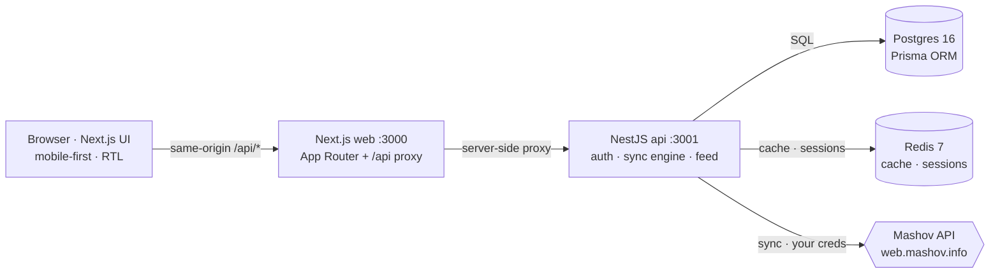

<div align="center">

# 🎒 Mashov Parent Command Center

**The school portal a busy parent can actually keep up with** — _glance · triage · done in 30 seconds_

[](https://github.com/mitekk/mashov/actions/workflows/ci.yml)


A mobile-first, Hebrew/RTL household dashboard over Israel's [Mashov](https://web.mashov.info)
school system. Sign in once with your existing Mashov account and get a single, aggregated
briefing across all your children — what changed, who needs attention, and which school
messages are waiting.

**🔗 Live — [mashov.mitya.dev](https://mashov.mitya.dev)**

</div>

> ⚠️ **Unofficial companion — not affiliated with or endorsed by Mashov
> ([web.mashov.info](https://web.mashov.info)).** You sign in with your own school credentials;
> the app is **read-only** and never writes back to the portal. Stored credentials are encrypted
> at rest.

---

- **For parents** — [What it is](#what-it-is) · [What you get](#what-you-get) · [How it works](#how-it-works) · [Good to know](#good-to-know)
- **For developers** — [Quick start](#quick-start) · [Architecture](#architecture) · [Tech stack](#tech-stack) · [Testing](#testing) · [Configuration](#configuration) · [Docs & decisions](#docs--decisions)

---

## 🏠 For parents

### What it is

The school portal already has all your kids' data — it's just exhausting to use day to day. You
log in, navigate a heavy legacy interface, switch context between children, and reassemble "what
changed" from a half-dozen screens. Every time.

This app removes that. It's a calm, low-click **summary and triage layer** over Mashov that
answers one question fast: *what changed, who it affects, and what needs attention right now.* The
goal is to understand your whole household's school status in **under 30 seconds**, without
hunting through menus.

### What you get

- **📋 One daily briefing** — a single mixed feed of what changed across all your children, newest first.
- **🔔 Attention first** — surfaces who needs you: new unread messages, behavior and attendance events, and recently assigned homework.
- **✉️ Clean inbox** — read school messages without the legacy clutter, with exact unread counts and attachment indicators.
- **🧒 Per-child workspace** — homework history, a behavior & attendance timeline, subjects & teachers, and the weekly timetable for each child.
- **🔑 No new account** — sign in with your existing Mashov school credentials; nothing extra to remember.
- **📱 Mobile-first & RTL** — designed for the phone and built for Hebrew (including mixed Hebrew/English) from the ground up.
- **🔒 Private by default** — each parent gets their own read/handled state, and stored credentials are encrypted at rest.

### How it works

1. **Sign in** — pick your school and log in with your Mashov username and password (the school year is detected automatically). If Mashov asks for a one-time code, wants your password changed, or needs a username set, that all happens here rather than sending you to Mashov's own site. Forgot your password? There is a recovery flow too.
2. **First sync** — the app pulls your household's latest data once in the background.
3. **Glance** — open it whenever, see what's new across all your kids, and drill into a single message or child only if you need to.

### Signing in when Mashov says no

Mashov can refuse a correct password for several reasons, and each one used to
be a dead end. All of them are now handled in the app
([ADR-0042](docs/adr/0042-in-app-mashov-auth-surface.md)):

| Mashov wants | What you see |
|---|---|
| A one-time code (MFA) | A code screen, with a resend button |
| Your password changed | A change-password screen that signs you straight in |
| A username set | The same screen, asking for a username too |
| A captcha | A link out to Mashov's own page — we do not pretend to solve it |
| You forgot your password | "שכחתי סיסמה" → a code by email or SMS, then a new password |

Two constraints worth knowing up front:

- **The first sign-in for a school has to use a password.** Background updates
  re-login by decrypting a stored password, so a household that only ever
  signed in with a one-time code would see data that never refreshes.
- **Signing in with a one-time code is not supported, and cannot be.** Mashov
  protects that flow with a Cloudflare captcha that only its own site can
  issue, so an app like this one cannot use it. Password sign-in is the way in;
  if you have forgotten yours, the recovery flow above will set a new one. See
  ADR-0042 §12.

### Good to know

This is a reading and triage companion, **not** a rebuild of the school portal. It's read-only by
design and intentionally scoped — it does **not** include grades, report cards, or performance
analytics. Think "daily briefing," not "admin portal."

## 🛠️ For developers

### Quick start

```bash
cp .env.example .env        # then fill in your Mashov credentials
docker compose up --build   # db, redis, backend, frontend (hot reload via the override file)
```

| Service | URL | Notes |
|---|---|---|
| Frontend (Next.js) | <http://localhost:3000> | the app; host port overridable with `FRONTEND_PORT` |
| Backend (NestJS) | <http://localhost:3001> | health check at `/health`; host port overridable with `BACKEND_PORT` |
| PostgreSQL | `localhost:5432` | host port overridable with `DB_PORT` |
| Redis | `localhost:6379` | cache + sessions |

> **Requirements:** Docker + Docker Compose v2. Node 22+ is only needed for host-side tooling;
> `docker compose up` is the supported path.

### Architecture

The browser only ever calls the **same-origin** `/api/*`; the Next.js server proxies those to the
NestJS API. The API owns a per-household **sync engine** that pulls from the upstream Mashov API
with your credentials into Postgres, and uses Redis for caching and sessions.



```
.
├── frontend/   # Next.js + TypeScript UI (mobile-first, RTL) + /api proxy
├── backend/    # NestJS API + per-household sync engine (Prisma)
├── docs/       # PRD, ADRs (0001–0023), architecture, API contract
├── ops/        # egress proxy provisioning + diagnostics
└── tests/      # integration + Playwright e2e
```

See [`docs/architecture.md`](docs/architecture.md) for the full design.

### Tech stack

| Layer | Tech |
|---|---|
| Frontend | Next.js 15 (App Router) · React 19 · TanStack Query · TypeScript |
| Backend | NestJS 11 · per-household sync engine · TypeScript |
| Data | PostgreSQL 16 · Prisma ORM |
| Cache / sessions | Redis 7 |
| Infrastructure | Docker Compose |

### Testing

All suites run inside the containers (`--profile test`):

```bash
npm run test:unit         # backend unit tests
npm run test:integration  # backend API integration tests
npm run test:e2e          # full-stack Playwright e2e
```

`test:unit` and `test:integration` run against `db-test`, a throwaway Postgres on
tmpfs that exists only under the `test` profile. They never touch the `db` your dev
stack uses — which matters, because the integration suite starts with
`prisma db push --force-reset` and would otherwise drop every table in it.

`test:e2e` is **not** isolated this way: it drives the real `backend` service and so
writes into the dev database. It does not reset it, but it does leave test data
behind. Point `DATABASE_URL` elsewhere first if that matters to you.

### Configuration

Copy `.env.example` to `.env`. The one value you **must** set is `ENCRYPTION_KEY`.

**The app holds no Mashov account of its own.** Every upstream call authenticates
as the household connection that owns the data, using credentials each parent
supplies in-app and which are stored encrypted at rest. There is deliberately no
`MASHOV_USERNAME` / `MASHOV_PASSWORD` / `MASHOV_SEMEL`: a shared operator account
would read one household's data with another household's login, and a public
deployment must never hold one person's school credentials. Sign in and add a
school through the app to get started.

| Variable | What |
|---|---|
| `ENCRYPTION_KEY` | 64-char hex key; encrypts stored credentials at rest |
| `MASHOV_YEAR` | *optional.* The **earliest** school year to **read**, not the year in scope. It cannot change which year is current: that is resolved from upstream and persisted on the connection. It no longer *fetches* anything — the nightly history backfill was removed with the rest of the unsolicited background work ([ADR-0046](docs/adr/0046-no-shared-mashov-account.md)), so this now only widens the window over history already in the database. A value later than the current year is ignored with a warning. To change the year the app actually uses, see [docs/ops/school-year-hotfix.md](docs/ops/school-year-hotfix.md) and [ADR-0025](docs/adr/0025-school-year-history-window.md). |

`DATABASE_URL`, `REDIS_URL`, the session/CORS settings, and the `FEATURE_*` flags all ship with
working defaults in [`.env.example`](.env.example). Never commit `.env`.

Egress and timeout knobs (see [Reaching Mashov](#reaching-mashov) below):

| Variable | What | Default |
|---|---|---|
| `DB_PORT` | host port the Postgres container publishes on. Containers always reach the database as `db:5432`, so this moves the host side only — set it when something else already holds 5432. | `5432` |
| `BACKEND_PORT` | host port the backend publishes on. The frontend proxy always reaches it as `backend:3000`, so this moves the host side only — set it to lift a second copy of the stack (a worktree, say) beside a running one. | `3001` |
| `FRONTEND_PORT` | host port the frontend publishes on, same rationale as `BACKEND_PORT`. | `3000` |
| `MASHOV_BASE_URL` | upstream Mashov origin | `https://web.mashov.info` |
| `HTTPS_PROXY` | egress proxy for Mashov calls — **required in production** | unset |
| `MASHOV_TIMEOUT_MS` | wall-clock bound per Mashov request | `10000` |
| `PROXY_TIMEOUT_MS` | bound per backend call from the frontend `/api/v1/*` proxy | `15000` |
| `PROXY_SLOW_TIMEOUT_MS` | bound for long synchronous paths (`/api/v1/sync/*`) | `90000` |
| `PROXY_ATTACHMENT_TIMEOUT_MS` | bound for attachment downloads (`/api/v1/{mail,children}/**/files/*`) | `45000` |
| `ENABLE_E2E_AUTH_BYPASS` | **tests only** — `1` lets the e2e browser skip the auth guard. Must stay unset or `0` in production. | `0` |
| `MAIL_SWEEP_ENABLED` | kill switch for the mail unread reconciliation sweep. Set to `false` to freeze the inbox badge in place while a wrong count is diagnosed — the walk and the per-conversation derivation keep running, only the orphan sweep stops. Anything else, including unset, leaves it on. | `true` |
| `MASHOV_ENABLE_SCHOOL_LINK_ADOPTION` | whether signing in with a school's credentials attaches to the household that already linked it. Off (`false`) restores the pre-merge behaviour, where each school's Mashov account gets its own separate household — which makes linking a second school a dead end, since signing back in with it shows an empty app. See ADR-0029. | `true` |

### Daily digest to Telegram

A per-child Hebrew briefing, pushed hourly until 19:00 Asia/Jerusalem — but only when that
child has something unreported, and never before that child's own school day is over. The cron
is awake from 11:00; each child is then held until their last lesson for the day ends plus
`DIGEST_POST_DISMISSAL_GRACE_MINUTES`, read from their timetable and their school's bell
schedule (ADR-0040). A held hour claims nothing, so nothing is lost by waiting; a child with
no timetable for today is not held at all; and a release time later than the 19:00 tick is
clamped back to it, so no child's day can be held past the end of it. Nothing new means no model call, no
message, no cost. Delivery is opt-in per child: a child gets a digest only if an enabled recipient row exists for
it. A parent creates those rows themselves, in `עוד` → `עדכונים בטלגרם` — see
**Connecting a parent's Telegram** below.

| Variable | What | Default |
|---|---|---|
| `DIGEST_ENABLED` | master switch for the hourly cron | `false` |
| `DIGEST_DRY_RUN` | renders and logs the message, sends nothing | `true` |
| `DIGEST_TIMEZONE` | also defines "today" and "tomorrow" | `Asia/Jerusalem` |
| `DIGEST_DUE_LOOKBACK_DAYS` | how far back to look for homework that may be needed tomorrow | `14` |
| `DIGEST_NEW_LOOKBACK_DAYS` | how far back to look for homework to report as newly assigned | `3` |
| `DIGEST_ACTIVITY_WINDOW_DAYS` | how far ahead an unanswered consent deadline is worth mentioning | `7` |
| `DIGEST_POST_DISMISSAL_GRACE_MINUTES` | how long after a child's last bell to wait before sending, so the register is filled in. `0` gates on the bell itself; anything above 180 is clamped — it is minutes, not milliseconds | `30` |
| `DIGEST_BOARD_LOOKBACK_DAYS` | how recently a message-board notice must have been first seen to count as news | `2` |
| `DIGEST_GRADE_LOOKBACK_DAYS` | how recently a mark must have been keyed in by a teacher to count as news. Measured from `enteredAt`, not from the date the assessment was sat | `2` |
| `DIGEST_MUTED_BEHAVIOR_CODES` | behaviour event codes never reported. `18` is נוכחות — a presence row per lesson per day, which tells a parent nothing. Set to empty to mute nothing | `18` |
| `DIGEST_LLM_MODEL` | model that writes the Hebrew prose | `claude-sonnet-5-5` |
| `DIGEST_LLM_EFFORT` | how hard it thinks first — `low`/`medium`/`high`/`xhigh`/`max` | `low` |
| `DIGEST_LLM_TIMEOUT_MS` | bound per summarization call | `30000` |
| `PUBLIC_BASE_URL` | origin Telegram messages link back to — must be the origin the frontend is served from, e.g. `https://mashov.mitya.dev`. Unset renders no link line at all. Only `https://`, or `http://localhost` for a dev stack | unset |
| `ANTHROPIC_API_KEY` | **secret.** Omit it and the digest still sends, using the deterministic renderer | unset |
| `INBOX_NOTIFY_ENABLED` | master switch for the ten-minute inbox notification cron | `false` |
| `INBOX_NOTIFY_DRY_RUN` | renders and logs the message, sends nothing, claims nothing | `true` |
| `INBOX_NOTIFY_QUIET_FROM` / `_TO` | the window the notifier stays silent. Mail arriving inside it is **held over**, not dropped | `21:00` / `07:00` |
| `INBOX_NOTIFY_LOOKBACK_HOURS` | how far back a run looks for mail it has not sent — also the carry-over window for the quiet hours | `24` |
| `INBOX_NOTIFY_MAX_PER_RUN` | above this, one summary message goes out instead of a burst | `5` |
| `INBOX_NOTIFY_BODY_CHARS` | how much of a mail body goes in the chat before it is cut | `700` |
| `TELEGRAM_MEDIA_ENABLED` | forwards Mashov attachments into the chat. Defaults **on** — the digest's own switches still gate every caller | `true` |
| `MEDIA_MAX_FILES_PER_MESSAGE` | files one message will carry; the overflow becomes a line in the text | `3` |
| `MEDIA_TOTAL_BYTES_PER_RUN` | byte budget for one batch of downloads; a bound on the host, not on Telegram | `52428800` |
| `MEDIA_SEND_DELAY_MS` | pause between uploads — Telegram allows about one message a second per chat | `1100` |
| `TELEGRAM_MEDIA_MAX_BYTES` | largest attachment forwarded into a chat; above it the parent gets a link instead | `20971520` |
| `TELEGRAM_PHOTO_MAX_BYTES` | above this a jpeg/png is sent as a document — `sendPhoto` re-encodes and downscales | `5242880` |
| `MEDIA_DOWNLOAD_TIMEOUT_MS` | per-download override of `MASHOV_TIMEOUT_MS` for attachment bytes | `45000` |
| `TELEGRAM_HTML_ENABLED` | sends the digest and inbox messages with Telegram's HTML parse mode, so titles are bold and items link to the page they are about. Defaults **on**; `false` sends the same text flat, with the tags stripped and each link flattened to `label: url` so the escape hatch keeps the deep links | `true` |
| `TELEGRAM_BOT_TOKEN` | **secret.** From BotFather. Also the master switch for the link wizard: without it the mint route answers `503` and the poller never starts | unset |
| `TELEGRAM_LINK_CODE_TTL_MINUTES` | how long a one-time link code stays valid | `15` |
| `TELEGRAM_POLL_TIMEOUT_SECONDS` | how long each `getUpdates` long poll waits | `30` |
| `TELEGRAM_POLL_ENABLED` | set `false` to stop polling — required if you ever set a webhook on the bot, since Telegram refuses `getUpdates` while one is active | `true` |
| `FEEDBACK_TELEGRAM_BOT_TOKEN` | **secret.** From BotFather, and a **different bot** from `TELEGRAM_BOT_TOKEN` above — the operator is also a parent user, so one bot would interleave parents' bug reports with that operator's own children's digests. No fallback between them: unset means nothing is sent, never sent as the parent-facing bot | unset |
| `FEEDBACK_TELEGRAM_CHAT_ID` | the private channel reports are delivered to, as a `-100…` id. The bot must be an **admin with post rights**; see [`docs/ops/admin-access-setup.md`](docs/ops/admin-access-setup.md) | unset |
| `FEEDBACK_NOTIFY_MAX_PER_RUN` | rows one outbox tick will try. A runaway guard, not a throughput knob | `20` |

The two `FEEDBACK_TELEGRAM_*` vars are the whole switch for operator notifications: both set
means on, either missing means off — silently, with no query and no log line on any of the
cron's 720 ticks a day. There is deliberately no `FEEDBACK_NOTIFY_ENABLED`; they are not flags
but the two halves of one address. See ADR-0045 §3 and §11.

> **These two flags now also gate all background syncing.** Since ADR-0046, the
> app fetches from Mashov in the background *only* for households that opted
> into notifications, and only shortly before their delivery window — see
> [Background syncing](#background-syncing). With both flags at their `false`
> default, a deployment makes **no** background upstream requests at all. Data
> moves on sign-in, on a page view whose local copy has lapsed, and when
> somebody presses refresh. That is intended for a public deployment, not a
> misconfiguration.

Both defaults are deliberately inert: merging the feature changes nothing until `DIGEST_ENABLED`
is `true`, and even then `DIGEST_DRY_RUN` keeps it from messaging anyone until you set it to
`false`. Check what it *would* have sent with `GET /api/v1/digest/deliveries`, which records
every run — including the quiet ones, since silence is otherwise indistinguishable from a broken
job.

The model only writes prose. The report's structure, the item list, and the `צפי הגשה`
(*estimated submission*) label are owned by a template, and every failure mode — missing key,
timeout, refusal, malformed output — falls back to deterministic Hebrew and still sends.

> **The submission date is an estimate, not a deadline.** Mashov exposes no homework due-date
> field, only when the work was given. The digest estimates from an explicit date written in the
> teacher's text, else the group's next lesson, and labels it as an estimate.
> See [ADR-0027](docs/adr/0027-derived-homework-deadlines.md).

### Connecting a parent's Telegram

A parent opens `עוד` → `עדכונים בטלגרם`, picks which children to hear about, taps one button,
and presses START in Telegram. They type nothing: the backend reads their chat id out of that
START and writes the recipient rows itself. Per-child toggles and a disconnect live back in
`עוד` afterwards.

A Telegram bot can never start a conversation — it may only message a chat that has already
pressed START on it — so that press is unavoidable in any design. What this avoids is making
the parent *also* find `@userinfobot` and retype a number, which buys nothing and verifies
nothing.

Setting it up as an operator is one step: get a token from `@BotFather` and set
`TELEGRAM_BOT_TOKEN`. The bot's `@username` is read from Telegram's own `getMe`, not
configured, so it cannot drift from the deployed token. Without a token the wizard says the
server is not set up for Telegram rather than rendering a dead link.

The chat id arrives over `getUpdates` long-polling, not a webhook: a webhook needs a public
HTTPS URL Telegram can reach, and this stack is local Docker behind NAT. The two are **mutually
exclusive on one bot** — if you ever call `setWebhook`, set `TELEGRAM_POLL_ENABLED=false`, and
only one backend replica may poll. See
[ADR-0033](docs/adr/0033-parent-driven-telegram-linking.md).

> **The link code is a credential.** A guessed code would bind the guesser's own chat to another
> family's account and start streaming that family's children's behaviour reports to them.
> Hence 16 random bytes, single-use, a 15-minute TTL, and a rate-limited mint route. Only a
> private Telegram chat can be bound — a forwarded deep link tapped in a group is refused.

Subscribing a child requires that one of the parent's own connections lists them, which is
stricter than being able to *see* them: a child no connection lists yet is visible in the app
but cannot be subscribed until the next successful roster sync attributes them. That is
deliberate — the cost of guessing wrong here is another family's conduct reports on a
stranger's phone.

To try it on your own machine — including the Telegram RTL check, which no test can make —
follow [docs/ops/digest-local-test.md](docs/ops/digest-local-test.md). It seeds a synthetic
child with today's data, because the digest reports only today and a quiet school day proves
nothing.

Neither the Telegram client nor the Anthropic client uses `HTTPS_PROXY`: that hop is a single
residential box provisioned for Mashov only. See
[ADR-0026](docs/adr/0026-outbound-digest-delivery-and-llm-egress.md), which also records what
child data reaches the model (first names only) and what does not.

### Background syncing

The app used to run 19 sync tasks on their own crons, each fanning out across
*every* active household and *every* active child whether or not anyone was
looking — on the order of **1,300–1,400 upstream requests and ~48 full logins
per household per day**, a good share of it for data no page renders. For a
public resource that is both an abuse signal to Mashov and needless write load
here. [ADR-0046](docs/adr/0046-no-shared-mashov-account.md) replaced it.

**Where fetching happens now**

| Trigger | What it fetches | Who gets it |
|---|---|---|
| Sign-in, and adding a school | the `login` set: roster, homework, behaviour, mail, behaviour codes — what `/home` and `/children` render | everyone |
| Page view with a lapsed local copy | that page's own sources (timetable, bells, subjects, notices, grades, profile) | everyone |
| The refresh button | the `login` set again, ignoring TTLs | everyone |
| `NotificationWindowTask` at **:50 of 10:00–18:00** Jerusalem | the `digest` set, just before each 11:00–19:00 digest tick | households with notifications on |
| `NotificationWindowTask` every **30 min, 07:00–20:59** Jerusalem | mail, inside the inbox notifier's non-quiet window | households with notifications on |

Rough arithmetic for one connection and two children, with notifications on:
~58 requests a day from the digest-lead ticks (most sources are inside their
TTL on most ticks) plus ~84 from the mail ticks, and one login — call it **~140
requests and 1 login**, against ~1,350 and ~48 before. Estimates, not
measurements: the real figure moves with how many children, schools and
conversations a household has.

A household that has not enabled notifications gets **zero** background
requests. Its data is as fresh as its last visit — which is why the `login` set
runs on every sign-in and why page views freshen what they show.

Only two sync crons remain, both in `NotificationWindowTask` and both gated on
`DIGEST_ENABLED` / `INBOX_NOTIFY_ENABLED`. The daily school-year rollover and
the nightly `sync_run` prune stay: the first is one cheap login per connection
and prevents a whole-year data outage, the second is database-only.

**How often a source is worth fetching** lives in one table,
[`backend/src/sync/source-policy.ts`](backend/src/sync/source-policy.ts), which
also drives what `/more` reports as stale. The reported threshold is *derived*
from the sync interval, so a source can never be called stale faster than its
own schedule could refresh it. Per-source overrides:

| Variable | What | Default |
|---|---|---|
| `SYNC_TTL_<SOURCE>_MINUTES` | how old the local copy must be before anything fetches it. `<SOURCE>` is the upper-snake source name, e.g. `SYNC_TTL_MAIL_INBOX_MINUTES`, `SYNC_TTL_TIMETABLE_MINUTES` | per source: 15 min (mail) to 30 days (behaviour codes) |
| `SYNC_STALE_<SOURCE>_MINUTES` | what `/more` reports as stale | 2× the TTL, floor 60 min |
| `SYNC_ON_READ_BUDGET_MS` | how long a page view waits for a fetch when it has nothing to render. Past this it serves the stale copy | `4000` |
| `SYNC_ON_READ_MAX_INFLIGHT` | concurrent read-path fetches per process; past this, pages serve stale. The circuit breaker that stops a traffic spike here becoming one upstream | `4` |
| `SYNC_ON_READ_RETRY_MINUTES` | after a failed read-path fetch, how long before another is attempted. Without a backoff a broken upstream means a fresh login on every request | `15` |
| `NOTIFY_SYNC_JITTER_MS` | random delay per household, so N households do not hit Mashov on the same second. `0` disables it | `15000` |
| `NOTIFY_SYNC_TICK_BUDGET_MS` | abandon a scheduler tick that overruns, so it cannot collide with the next | `600000` |

Raising a TTL lowers upstream traffic and makes data staler; lowering it does
the reverse. The defaults are the quiet end, so an unset environment is the
conservative one.

**One coupling worth knowing.** The digest reports a quiet child as
`skipped_stale` rather than `skipped_empty` if `homework`/`behavior` have no
successful sync within six hours. That used to be guaranteed by 12-minute
crons; it is now guaranteed by the `:50` lead tick alone. Push that tick later
than the digest it feeds and every quiet child is reported stale, permanently
and silently — so `notification-window.task.spec.ts` pins the relationship
against the real constant.

### Reaching Mashov

Mashov **blocks the production server's IP**: `GET /api/schools` returns 403 from the server and
200 from a residential address. Every Mashov call therefore egresses through an HTTP proxy on an
always-on box with a residential connection, reached over a private VPN and pointed at by
`HTTPS_PROXY`.

```
backend ──HTTPS_PROXY──> tinyproxy on a residential host ──> web.mashov.info
         (private VPN)        (ACL: backend host only)
```

Provision or repair that hop with [`ops/install-egress-proxy.sh`](ops/install-egress-proxy.sh);
diagnose it from the backend host with [`ops/check-egress.sh`](ops/check-egress.sh). If sign-in
breaks and the school dropdown stays empty, run the diagnostic first — it separates the three
failure modes that are indistinguishable from inside the app:

| Symptom at the proxy | Meaning |
|---|---|
| TCP times out, no refusal | The proxy host has left the VPN. Check its node key. |
| TCP refused | Host is up, proxy service is down. Re-run the install script. |
| Connects but returns 403 | Proxy works but is egressing from a blocked IP. |

**Why the timeouts are separate knobs.** When the proxy host drops off the VPN it *blackholes*
traffic — packets vanish rather than being refused — and axios' own `timeout` never arms, because
it is started by `req.setTimeout()` once a socket is assigned and `HttpsProxyAgent` defers
assignment until CONNECT completes. Every Mashov request is therefore additionally bounded by an
`AbortSignal`, which starts counting immediately. A stalled egress path surfaces as a 502 in ~10s
instead of a CDN gateway timeout after ~125s. See
[ADR-0023](docs/adr/0023-bounding-mashov-egress-abortsignal.md).

### Docs & decisions

- **Product:** [`docs/prd/PRD-current.md`](docs/prd/PRD-current.md) (history: [`docs/prd/`](docs/prd/))
- **Architecture:** [`docs/architecture.md`](docs/architecture.md) · **API contract:** [`docs/api-contract.md`](docs/api-contract.md)
- **Decisions:** [`docs/adr/`](docs/adr/) — ADR 0001–0042 ([index](docs/adr/README.md))
