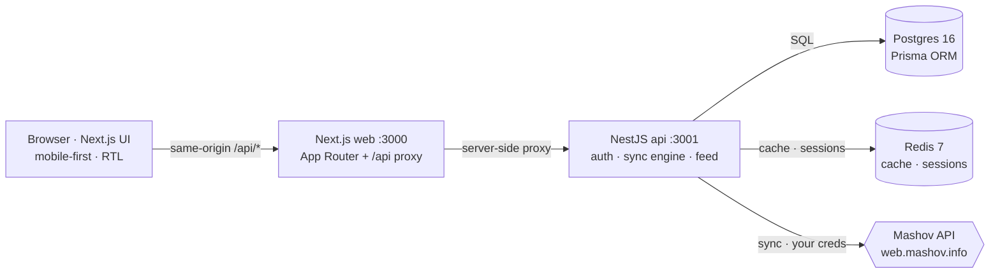

<div align="center">

# 🎒 Mashov Parent Command Center

**The school portal a busy parent can actually keep up with** — _glance · triage · done in 30 seconds_

[](https://github.com/mitekk/mashov/actions/workflows/ci.yml)


A mobile-first, Hebrew/RTL household dashboard over Israel's [Mashov](https://web.mashov.info)
school system. Sign in once with your existing Mashov account and get a single, aggregated
briefing across all your children — what changed, who needs attention, and which school
messages are waiting.

**🔗 Live — [mashov.mitya.dev](https://mashov.mitya.dev)**

</div>

> ⚠️ **Unofficial companion — not affiliated with or endorsed by Mashov
> ([web.mashov.info](https://web.mashov.info)).** You sign in with your own school credentials;
> the app is **read-only** and never writes back to the portal. Stored credentials are encrypted
> at rest.

---

- **For parents** — [What it is](#what-it-is) · [What you get](#what-you-get) · [How it works](#how-it-works) · [Good to know](#good-to-know)
- **For developers** — [Quick start](#quick-start) · [Architecture](#architecture) · [Tech stack](#tech-stack) · [Testing](#testing) · [Configuration](#configuration) · [Docs & decisions](#docs--decisions)

---

## 🏠 For parents

### What it is

The school portal already has all your kids' data — it's just exhausting to use day to day. You
log in, navigate a heavy legacy interface, switch context between children, and reassemble "what
changed" from a half-dozen screens. Every time.

This app removes that. It's a calm, low-click **summary and triage layer** over Mashov that
answers one question fast: *what changed, who it affects, and what needs attention right now.* The
goal is to understand your whole household's school status in **under 30 seconds**, without
hunting through menus.

### What you get

- **📋 One daily briefing** — a single mixed feed of what changed across all your children, newest first.
- **🔔 Attention first** — surfaces who needs you: new unread messages, behavior and attendance events, and recently assigned homework.
- **✉️ Clean inbox** — read school messages without the legacy clutter, with exact unread counts and attachment indicators.
- **🧒 Per-child workspace** — homework history, a behavior & attendance timeline, subjects & teachers, and the weekly timetable for each child.
- **🔑 No new account** — sign in with your existing Mashov school credentials; nothing extra to remember.
- **📱 Mobile-first & RTL** — designed for the phone and built for Hebrew (including mixed Hebrew/English) from the ground up.
- **🔒 Private by default** — each parent gets their own read/handled state, and stored credentials are encrypted at rest.

### How it works

1. **Sign in** — pick your school and log in with your Mashov username and password (the school year is detected automatically).
2. **First sync** — the app pulls your household's latest data once in the background.
3. **Glance** — open it whenever, see what's new across all your kids, and drill into a single message or child only if you need to.

### Good to know

This is a reading and triage companion, **not** a rebuild of the school portal. It's read-only by
design and intentionally scoped — it does **not** include grades, report cards, or performance
analytics. Think "daily briefing," not "admin portal."

## 🛠️ For developers

### Quick start

```bash
cp .env.example .env        # then fill in your Mashov credentials
docker compose up --build   # db, redis, backend, frontend (hot reload via the override file)
```

| Service | URL | Notes |
|---|---|---|
| Frontend (Next.js) | <http://localhost:3000> | the app |
| Backend (NestJS) | <http://localhost:3001> | health check at `/health` |
| PostgreSQL | `localhost:5432` | |
| Redis | `localhost:6379` | cache + sessions |

> **Requirements:** Docker + Docker Compose v2. Node 22+ is only needed for host-side tooling;
> `docker compose up` is the supported path.

### Architecture

The browser only ever calls the **same-origin** `/api/*`; the Next.js server proxies those to the
NestJS API. The API owns a per-household **sync engine** that pulls from the upstream Mashov API
with your credentials into Postgres, and uses Redis for caching and sessions.



```
.
├── frontend/   # Next.js + TypeScript UI (mobile-first, RTL) + /api proxy
├── backend/    # NestJS API + per-household sync engine (Prisma)
├── docs/       # PRD, ADRs (0001–0023), architecture, API contract
├── ops/        # egress proxy provisioning + diagnostics
└── tests/      # integration + Playwright e2e
```

See [`docs/architecture.md`](docs/architecture.md) for the full design.

### Tech stack

| Layer | Tech |
|---|---|
| Frontend | Next.js 15 (App Router) · React 19 · TanStack Query · TypeScript |
| Backend | NestJS 11 · per-household sync engine · TypeScript |
| Data | PostgreSQL 16 · Prisma ORM |
| Cache / sessions | Redis 7 |
| Infrastructure | Docker Compose |

### Testing

All suites run inside the containers (`--profile test`):

```bash
npm run test:unit         # backend unit tests
npm run test:integration  # backend API integration tests
npm run test:e2e          # full-stack Playwright e2e
```

`test:unit` and `test:integration` run against `db-test`, a throwaway Postgres on
tmpfs that exists only under the `test` profile. They never touch the `db` your dev
stack uses — which matters, because the integration suite starts with
`prisma db push --force-reset` and would otherwise drop every table in it.

`test:e2e` is **not** isolated this way: it drives the real `backend` service and so
writes into the dev database. It does not reset it, but it does leave test data
behind. Point `DATABASE_URL` elsewhere first if that matters to you.

### Configuration

Copy `.env.example` to `.env`. The values you **must** set:

| Variable | What |
|---|---|
| `MASHOV_USERNAME` · `MASHOV_PASSWORD` | your Mashov login |
| `MASHOV_SEMEL` | school ID (semel) |
| `MASHOV_YEAR` | *optional.* The **earliest** school year to fetch from — not the year in scope. It cannot change which year is current: that is resolved from upstream and persisted on the connection. Unset, only the current year is fetched. Set to an earlier year, a nightly backfill fills that year in once, capped at two years back; a value later than the current year is ignored with a warning. To change the year the app actually uses, see [docs/ops/school-year-hotfix.md](docs/ops/school-year-hotfix.md) and [ADR-0025](docs/adr/0025-school-year-history-window.md). |
| `ENCRYPTION_KEY` | 64-char hex key; encrypts stored credentials at rest |

`DATABASE_URL`, `REDIS_URL`, the session/CORS settings, and the `FEATURE_*` flags all ship with
working defaults in [`.env.example`](.env.example). Never commit `.env`.

Egress and timeout knobs (see [Reaching Mashov](#reaching-mashov) below):

| Variable | What | Default |
|---|---|---|
| `MASHOV_BASE_URL` | upstream Mashov origin | `https://web.mashov.info` |
| `HTTPS_PROXY` | egress proxy for Mashov calls — **required in production** | unset |
| `MASHOV_TIMEOUT_MS` | wall-clock bound per Mashov request | `10000` |
| `PROXY_TIMEOUT_MS` | bound per backend call from the frontend `/api/v1/*` proxy | `15000` |
| `PROXY_SLOW_TIMEOUT_MS` | bound for long synchronous paths (`/api/v1/sync/*`) | `90000` |
| `PROXY_ATTACHMENT_TIMEOUT_MS` | bound for attachment downloads (`/api/v1/{mail,children}/**/files/*`) | `45000` |
| `ENABLE_E2E_AUTH_BYPASS` | **tests only** — `1` lets the e2e browser skip the auth guard. Must stay unset or `0` in production. | `0` |

### Daily digest to Telegram

A per-child Hebrew briefing, pushed hourly from 13:00 to 19:00 Asia/Jerusalem — but only when
that child has something unreported. Nothing new means no model call, no message, no cost.
Delivery is opt-in per child: a child gets a digest only if an enabled recipient row exists for
it (`POST /api/v1/digest/recipients`).

| Variable | What | Default |
|---|---|---|
| `DIGEST_ENABLED` | master switch for the hourly cron | `false` |
| `DIGEST_DRY_RUN` | renders and logs the message, sends nothing | `true` |
| `DIGEST_TIMEZONE` | also defines "today" and "tomorrow" | `Asia/Jerusalem` |
| `DIGEST_DUE_LOOKBACK_DAYS` | how far back to look for homework that may be needed tomorrow | `14` |
| `DIGEST_NEW_LOOKBACK_DAYS` | how far back to look for homework to report as newly assigned | `3` |
| `DIGEST_ACTIVITY_WINDOW_DAYS` | how far ahead an unanswered consent deadline is worth mentioning | `7` |
| `DIGEST_LLM_MODEL` | model that writes the Hebrew prose | `claude-sonnet-5-5` |
| `DIGEST_LLM_EFFORT` | how hard it thinks first — `low`/`medium`/`high`/`xhigh`/`max` | `low` |
| `DIGEST_LLM_TIMEOUT_MS` | bound per summarization call | `30000` |
| `ANTHROPIC_API_KEY` | **secret.** Omit it and the digest still sends, using the deterministic renderer | unset |
| `TELEGRAM_BOT_TOKEN` | **secret.** From BotFather | unset |

Both defaults are deliberately inert: merging the feature changes nothing until `DIGEST_ENABLED`
is `true`, and even then `DIGEST_DRY_RUN` keeps it from messaging anyone until you set it to
`false`. Check what it *would* have sent with `GET /api/v1/digest/deliveries`, which records
every run — including the quiet ones, since silence is otherwise indistinguishable from a broken
job.

The model only writes prose. The report's structure, the item list, and the `צפי הגשה`
(*estimated submission*) label are owned by a template, and every failure mode — missing key,
timeout, refusal, malformed output — falls back to deterministic Hebrew and still sends.

> **The submission date is an estimate, not a deadline.** Mashov exposes no homework due-date
> field, only when the work was given. The digest estimates from an explicit date written in the
> teacher's text, else the group's next lesson, and labels it as an estimate.
> See [ADR-0027](docs/adr/0027-derived-homework-deadlines.md).

To try it on your own machine — including the Telegram RTL check, which no test can make —
follow [docs/ops/digest-local-test.md](docs/ops/digest-local-test.md). It seeds a synthetic
child with today's data, because the digest reports only today and a quiet school day proves
nothing.

Neither the Telegram client nor the Anthropic client uses `HTTPS_PROXY`: that hop is a single
residential box provisioned for Mashov only. See
[ADR-0026](docs/adr/0026-outbound-digest-delivery-and-llm-egress.md), which also records what
child data reaches the model (first names only) and what does not.

### Reaching Mashov

Mashov **blocks the production server's IP**: `GET /api/schools` returns 403 from the server and
200 from a residential address. Every Mashov call therefore egresses through an HTTP proxy on an
always-on box with a residential connection, reached over a private VPN and pointed at by
`HTTPS_PROXY`.

```
backend ──HTTPS_PROXY──> tinyproxy on a residential host ──> web.mashov.info
         (private VPN)        (ACL: backend host only)
```

Provision or repair that hop with [`ops/install-egress-proxy.sh`](ops/install-egress-proxy.sh);
diagnose it from the backend host with [`ops/check-egress.sh`](ops/check-egress.sh). If sign-in
breaks and the school dropdown stays empty, run the diagnostic first — it separates the three
failure modes that are indistinguishable from inside the app:

| Symptom at the proxy | Meaning |
|---|---|
| TCP times out, no refusal | The proxy host has left the VPN. Check its node key. |
| TCP refused | Host is up, proxy service is down. Re-run the install script. |
| Connects but returns 403 | Proxy works but is egressing from a blocked IP. |

**Why the timeouts are separate knobs.** When the proxy host drops off the VPN it *blackholes*
traffic — packets vanish rather than being refused — and axios' own `timeout` never arms, because
it is started by `req.setTimeout()` once a socket is assigned and `HttpsProxyAgent` defers
assignment until CONNECT completes. Every Mashov request is therefore additionally bounded by an
`AbortSignal`, which starts counting immediately. A stalled egress path surfaces as a 502 in ~10s
instead of a CDN gateway timeout after ~125s. See
[ADR-0023](docs/adr/0023-bounding-mashov-egress-abortsignal.md).

### Docs & decisions

- **Product:** [`docs/prd/PRD-current.md`](docs/prd/PRD-current.md) (history: [`docs/prd/`](docs/prd/))
- **Architecture:** [`docs/architecture.md`](docs/architecture.md) · **API contract:** [`docs/api-contract.md`](docs/api-contract.md)
- **Decisions:** [`docs/adr/`](docs/adr/) — ADR 0001–0023 ([index](docs/adr/README.md))
