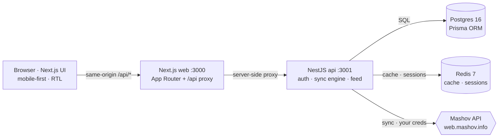

<div align="center">

# 🎒 Mashov Parent Command Center

**The school portal a busy parent can actually keep up with** — _glance · triage · done in 30 seconds_

[](https://github.com/mitekk/mashov/actions/workflows/ci.yml)


A mobile-first, Hebrew/RTL household dashboard over Israel's [Mashov](https://web.mashov.info)
school system. Sign in once with your existing Mashov account and get a single, aggregated
briefing across all your children — what changed, who needs attention, and which school
messages are waiting.

**🔗 Live — [mashov.mitya.dev](https://mashov.mitya.dev)**

</div>

> ⚠️ **Unofficial companion — not affiliated with or endorsed by Mashov
> ([web.mashov.info](https://web.mashov.info)).** You sign in with your own school credentials;
> the app is **read-only** and never writes back to the portal. Stored credentials are encrypted
> at rest.

---

- **For parents** — [What it is](#what-it-is) · [What you get](#what-you-get) · [How it works](#how-it-works) · [Good to know](#good-to-know)
- **For developers** — [Quick start](#quick-start) · [Architecture](#architecture) · [Tech stack](#tech-stack) · [Testing](#testing) · [Configuration](#configuration) · [Docs & decisions](#docs--decisions)

---

## 🏠 For parents

### What it is

The school portal already has all your kids' data — it's just exhausting to use day to day. You
log in, navigate a heavy legacy interface, switch context between children, and reassemble "what
changed" from a half-dozen screens. Every time.

This app removes that. It's a calm, low-click **summary and triage layer** over Mashov that
answers one question fast: *what changed, who it affects, and what needs attention right now.* The
goal is to understand your whole household's school status in **under 30 seconds**, without
hunting through menus.

### What you get

- **📋 One daily briefing** — a single mixed feed of what changed across all your children, newest first.
- **🔔 Attention first** — surfaces who needs you: new unread messages, behavior and attendance events, and recently assigned homework.
- **✉️ Clean inbox** — read school messages without the legacy clutter, with exact unread counts and attachment indicators.
- **🧒 Per-child workspace** — homework history, a behavior & attendance timeline, subjects & teachers, and the weekly timetable for each child.
- **🔑 No new account** — sign in with your existing Mashov school credentials; nothing extra to remember.
- **📱 Mobile-first & RTL** — designed for the phone and built for Hebrew (including mixed Hebrew/English) from the ground up.
- **🔒 Private by default** — each parent gets their own read/handled state, and stored credentials are encrypted at rest.

### How it works

1. **Sign in** — pick your school and log in with your Mashov username and password (the school year is detected automatically).
2. **First sync** — the app pulls your household's latest data once in the background.
3. **Glance** — open it whenever, see what's new across all your kids, and drill into a single message or child only if you need to.

### Good to know

This is a reading and triage companion, **not** a rebuild of the school portal. It's read-only by
design and intentionally scoped — it does **not** include grades, report cards, or performance
analytics. Think "daily briefing," not "admin portal."

## 🛠️ For developers

### Quick start

```bash
cp .env.example .env        # then fill in your Mashov credentials
docker compose up --build   # db, redis, backend, frontend (hot reload via the override file)
```

| Service | URL | Notes |
|---|---|---|
| Frontend (Next.js) | <http://localhost:3000> | the app |
| Backend (NestJS) | <http://localhost:3001> | health check at `/health` |
| PostgreSQL | `localhost:5432` | |
| Redis | `localhost:6379` | cache + sessions |

> **Requirements:** Docker + Docker Compose v2. Node 22+ is only needed for host-side tooling;
> `docker compose up` is the supported path.

### Architecture

The browser only ever calls the **same-origin** `/api/*`; the Next.js server proxies those to the
NestJS API. The API owns a per-household **sync engine** that pulls from the upstream Mashov API
with your credentials into Postgres, and uses Redis for caching and sessions.



```
.
├── frontend/   # Next.js + TypeScript UI (mobile-first, RTL) + /api proxy
├── backend/    # NestJS API + per-household sync engine (Prisma)
├── docs/       # PRD, ADRs (0001–0022), architecture, API contract
└── tests/      # integration + Playwright e2e
```

See [`docs/architecture.md`](docs/architecture.md) for the full design.

### Tech stack

| Layer | Tech |
|---|---|
| Frontend | Next.js 15 (App Router) · React 19 · TanStack Query · TypeScript |
| Backend | NestJS 11 · per-household sync engine · TypeScript |
| Data | PostgreSQL 16 · Prisma ORM |
| Cache / sessions | Redis 7 |
| Infrastructure | Docker Compose |

### Testing

All suites run inside the containers (`--profile test`):

```bash
npm run test:unit         # backend unit tests
npm run test:integration  # backend API integration tests
npm run test:e2e          # full-stack Playwright e2e
```

### Configuration

Copy `.env.example` to `.env`. The values you **must** set:

| Variable | What |
|---|---|
| `MASHOV_USERNAME` · `MASHOV_PASSWORD` | your Mashov login |
| `MASHOV_SEMEL` · `MASHOV_YEAR` | school ID (semel) + academic year |
| `ENCRYPTION_KEY` | 64-char hex key; encrypts stored credentials at rest |

`DATABASE_URL`, `REDIS_URL`, the session/CORS settings, and the `FEATURE_*` flags all ship with
working defaults in [`.env.example`](.env.example). Never commit `.env`.

### Docs & decisions

- **Product:** [`docs/prd/PRD-current.md`](docs/prd/PRD-current.md) (history: [`docs/prd/`](docs/prd/))
- **Architecture:** [`docs/architecture.md`](docs/architecture.md) · **API contract:** [`docs/api-contract.md`](docs/api-contract.md)
- **Decisions:** [`docs/adr/`](docs/adr/) — ADR 0001–0022 ([index](docs/adr/README.md))
